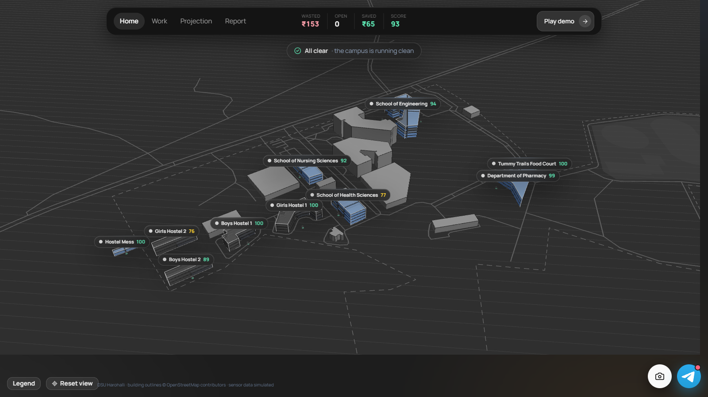
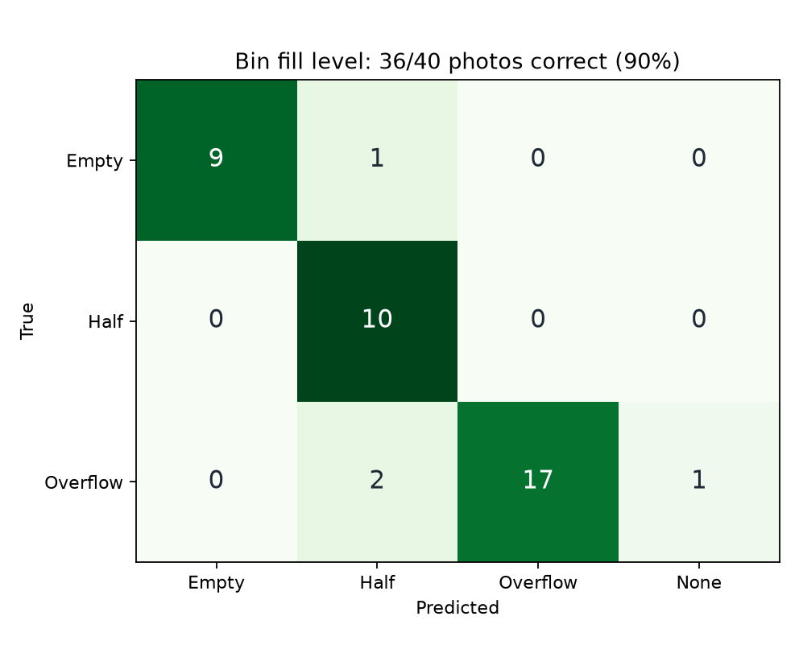
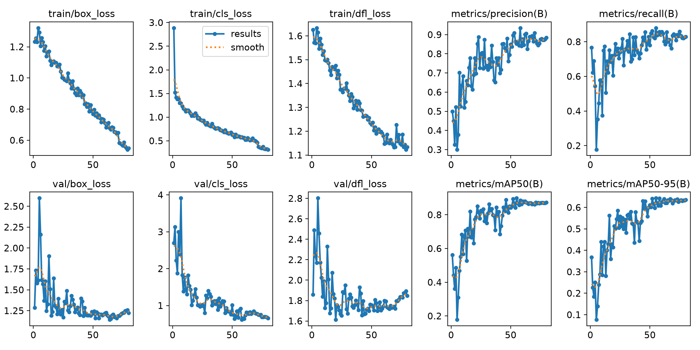
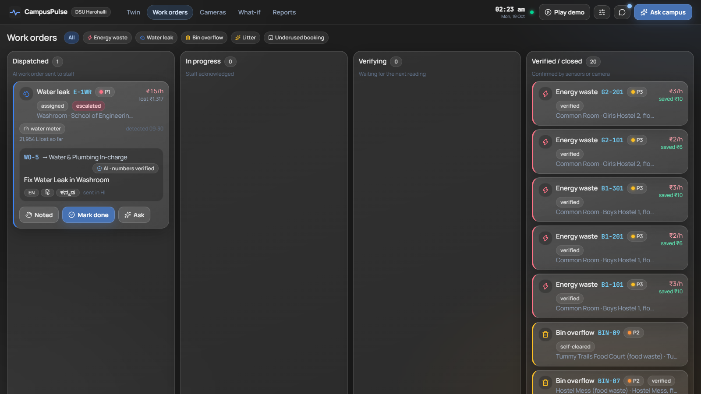
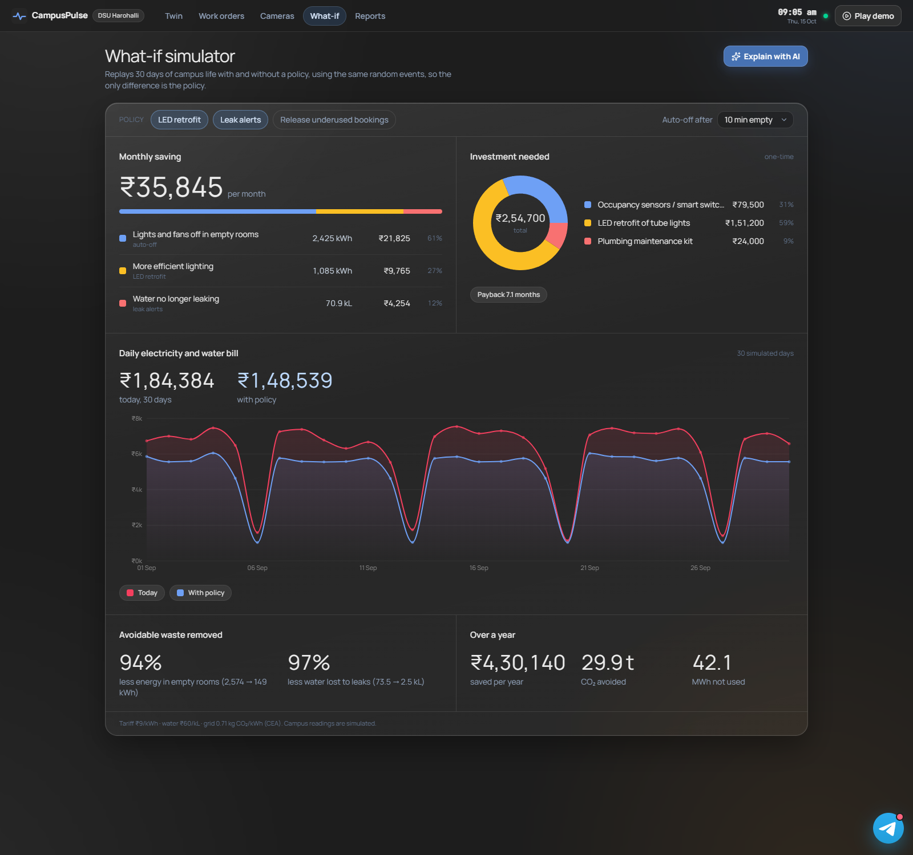
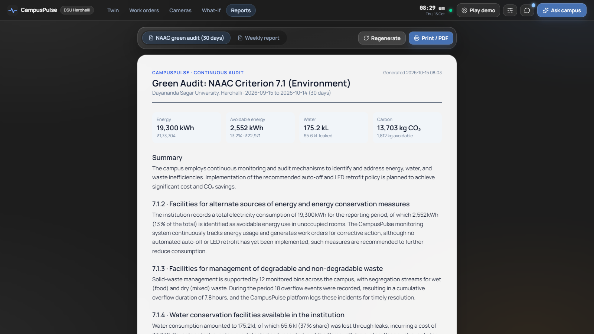
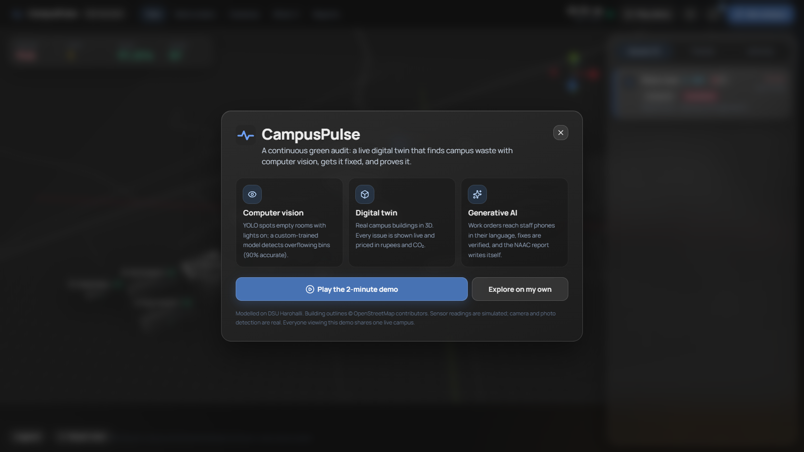
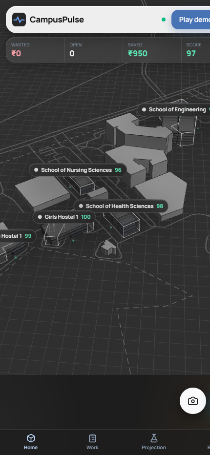
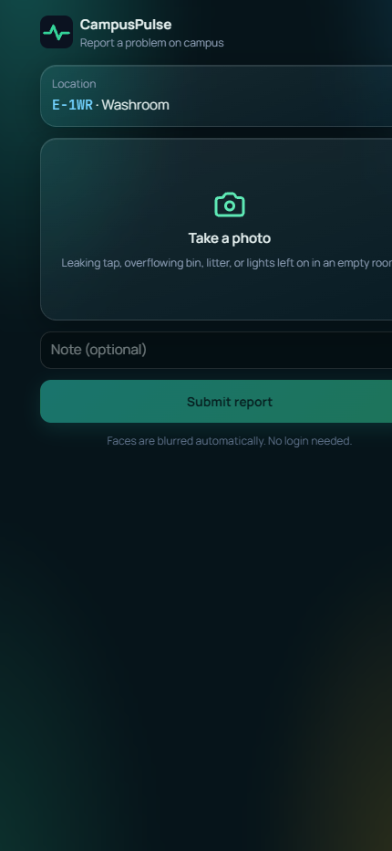

# CampusPulse: continuous green audit for college campuses

**Code Clash 2.0 · PS2: AI-Powered Sustainable Campus** (computer vision + digital twin + generative AI)

Every Indian college does its green audit (NAAC Criterion 7) once a year, by hand. CampusPulse does it continuously, on a live digital twin of **Dayananda Sagar University, Harohalli**. Computer vision and sensors catch energy waste, water leaks, overflowing bins and underused bookings. Each issue is priced in ₹ and CO₂, sent to the right staff member's phone in their language, verified when fixed, and rolled into a NAAC-ready report.



## Try it in 2 minutes

1. **Open the live app:** https://campuspulse-jb26.onrender.com
   (free hosting: the first load after a quiet spell can take ~30 s while the server wakes up)
2. Click **Play the 2-minute demo**. It runs by itself: lights are left on in a classroom, CampusPulse detects and prices the waste, writes a work order, the staff member taps Done, the twin verifies the fix, then it tours a leak, work orders, cameras, the what-if simulator and the NAAC report.
3. **Optional, to see the staff side on your own phone:** open [t.me/campuspulse_bot?start=judge](https://t.me/campuspulse_bot?start=judge) in Telegram and tap Start before playing the demo. You will receive a copy of each work order and can tap **Done** yourself.
4. **Try the computer vision:** open **Cameras** and click a sample bin photo (or upload your own). An overflowing bin raises a real issue on the twin. With a webcam, start the live camera: it counts people and checks whether lights are on.
5. **Explore:** click any room or bin for its live readings and QR code, open the staff messages with the Telegram button, or press **Ctrl+D** to trigger a scenario.

Everyone viewing the demo shares one simulated campus, so you may see issues others triggered.

## Results

| | |
|---|---|
| Bin fill-level model (YOLO11n, fine-tuned) | **90% of held-out photos correct** (36/40), **mAP50 0.898**, overflow recall 0.85 |
| CV inference on CPU (ONNX Runtime) | ~50–60 ms per frame, no GPU |
| What-if, default policy set on the simulated campus | about **₹35,800 / month** saved, payback ~7 months |
| Languages for staff work orders | English, हिन्दी, ಕನ್ನಡ |

<p>


</p>

Training and evaluation scripts are in [`training/`](training/) (`train_bin.py`, `eval_bin.py`, `bin_metrics.json`).

## Screenshots

| Work orders | What-if simulator |
|---|---|
|  |  |
| **NAAC green-audit report** | **Welcome screen** |
|  |  |

<p>


</p>

## What it does

| Feature | Details |
|---|---|
| **Digital twin of DSU Harohalli** | Real building outlines, floors, roads and grounds from OpenStreetMap. 65 simulated rooms and 12 bins placed inside 10 monitored buildings. Live state over WebSocket. |
| **Computer vision** | Live camera: YOLO11n people count, light state (calibrated per room), fan motion. Faces are blurred and nothing is stored. |
| **Trained bin model** | YOLO11n fine-tuned on Garbage_Fill_Level (Empty / Half / Overflow): **90% of held-out photos correct, mAP50 0.898**. See `training/`. |
| **Detection rules** | Energy waste (empty room, power on), water leak (flow vs. expected), bin overflow (+ time-to-full forecast), underused booking (timetable vs. occupancy). |
| **Staff work orders** | AI-written work order sent on **Telegram** to the right role, in **English / हिन्दी / ಕನ್ನಡ** (each person chooses). Staff tap **Noted / Done**, and the twin **verifies the fix** with the next reading. Unanswered P1/P2 issues escalate to the Estate Manager. WhatsApp (Meta Cloud API, Twilio) uses the same notifier interface. |
| **Student photo reports** | Scan a location QR → photo → trained model + vision LLM verify it → duplicates merge → same work-order loop. |
| **What-if simulator** | Replays 30 days with and without a policy (auto-off, LED retrofit, leak alerts, releasing underused bookings) → ₹ per month, CO₂ and payback. |
| **NAAC green audit** | Criterion 7.1 report and weekly report generated from live data, printable to PDF. |
| **Ask your campus** | Copilot with tool calling over live twin data. |
| **Numeric validator** | The LLM writes words; the engine computes numbers. AI text with a number not in the data is replaced by a template; IDs and numbers must survive translation. |

## Architecture

```
React + Three.js twin ──WebSocket──► FastAPI
  Work orders · Cameras · What-if    ├─ DataSource (simulator → swap for MQTT / BMS meters)
  Reports · Copilot · /report        ├─ Twin engine: detection rules, pricing, lifecycle, escalation
                                     ├─ CV: YOLO11n (people + bin model) on ONNX Runtime or PyTorch
                                     ├─ GenAI (Groq): work orders, translation, copilot, reports + validator
                                     └─ Notifier: Telegram | Meta WhatsApp Cloud API | Twilio | in-app
```

- **Data:** building geometry is real (© OpenStreetMap contributors, ODbL). Rooms, sensors and readings are **simulated**, priced with tariff, water-rate and CEA grid-emission constants in `backend/app/config.py`. CV inference is real. To connect real meters, write a new `DataSource`; the engine doesn't change.
- **Privacy:** camera frames are processed in memory, head regions are blurred, and only counts are kept.
- **Runs on CPU:** no GPU needed (ONNX Runtime, ~50–60 ms per frame).

## Run locally

```bash
# backend
cd backend
python -m venv .venv && .venv/Scripts/activate      # Linux/macOS: source .venv/bin/activate
pip install -r requirements.txt                       # or requirements-render.txt for the slim ONNX-only setup
cp .env.example .env                                  # add GROQ_API_KEY (free at console.groq.com) and optionally TELEGRAM_BOT_TOKEN
uvicorn app.main:app --port 8002

# frontend (new terminal)
cd frontend
npm install
npm run dev                                           # http://localhost:5173
```

Press **Ctrl+D** to trigger scenarios and change simulation speed. On the hosted site, reset / time-jump endpoints need `ADMIN_KEY`.

`CV_BACKEND` selects the vision runtime: `auto` (default: ONNX if `backend/models/*.onnx` exist, else PyTorch), `onnx` or `torch`.

## Deploy (Render, free tier)

`render.yaml` + `Dockerfile.render` deploy the whole app as one service (the backend serves the built frontend), using ONNX Runtime so it fits in 512 MB.
Render → **New → Blueprint** → this repo, then set the secrets `GROQ_API_KEY`, `TELEGRAM_BOT_TOKEN` and optionally `TELEGRAM_CHATS` (saved role links).
`Dockerfile` is the full PyTorch image; git tag `v1-pytorch` is the version before the ONNX switch.

## Tests

```bash
cd backend && python -m pytest -q
```

## Credits

- Map data © [OpenStreetMap](https://www.openstreetmap.org/copyright) contributors (ODbL).
- Bin dataset: *Garbage_Fill_Level* by charuka-edirisinghe, Roboflow Universe (CC BY 4.0).
- YOLO11 by Ultralytics

## Team

| Member | GitHub | Role |
|---|---|---|
| Jeet Bagdai | [@JeetBagdai](https://github.com/JeetBagdai) | _role_ |
| Sohan Vinod | [@Sohan258oss](https://github.com/Sohan258oss) | _role_ |
| Chiranth Yadalam | [@ChiranthYadalam](https://github.com/ChiranthYadalam) | _role_ |
| Ananth | [@agkkk](https://github.com/agkkk) | _role_ |
